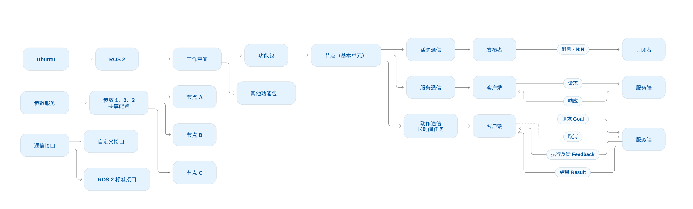
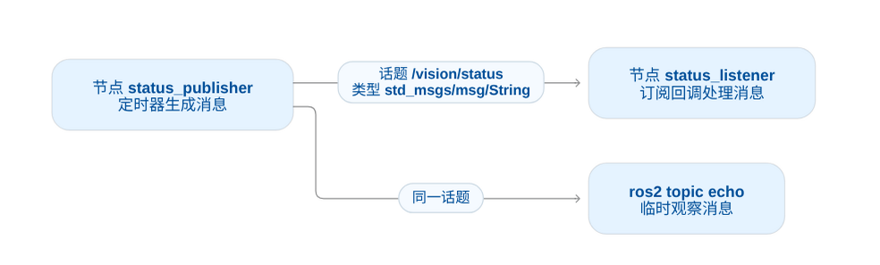

# ROS2

## 1. 概览

下载后ROS2后先配置终端环境

加载环境并确认所有工具可用，版本正确

```bash
xyzfrozen@xyzfrozen-B650M-AORUS-ELITE-AX-ICE:~$ source /opt/ros/humble/setup.bash
xyzfrozen@xyzfrozen-B650M-AORUS-ELITE-AX-ICE:~$ printenv ROS_DISTRO
humble
xyzfrozen@xyzfrozen-B650M-AORUS-ELITE-AX-ICE:~$ command -v ros2 colcon g++ cmake
/opt/ros/humble/bin/ros2
/usr/bin/colcon
/usr/bin/g++
/usr/bin/cmake
```


进入工作空间

```bash
xyzfrozen@xyzfrozen-B650M-AORUS-ELITE-AX-ICE:~$ mkdir -p /home/xyzfrozen/文档/联创/ros2_ws/src
xyzfrozen@xyzfrozen-B650M-AORUS-ELITE-AX-ICE:~$ cd /home/xyzfrozen/文档/联创/ros2_ws
xyzfrozen@xyzfrozen-B650M-AORUS-ELITE-AX-ICE:~/文档/联创/ros2_ws$ ls
src
```


一个完整项目的工作目录大概长成这样：

```
ros2_ws/
├── src/                         # 源码
│   ├── hello_cpp/               # 一个功能包
│   │   ├── package.xml          # 对包的一个简要介绍
│   │   ├── CMakeLists.txt
│   │   ├── src/
│   │   │   └── hello_node.cpp
│   │   ├── include/
│   │   │   └── hello_cpp/
│   │   │       └── hello_node.hpp
│   │   ├── launch/              # 启动文件
│   │   └── config/              # 参数等配置文件
│   └── sensor_driver/           # 另一个功能包
│       └── ...
├── build/                       # CMake 缓存、目标文件等中间产物
├── install/                     # 按安装规则整理好的可执行文件、库、配置、环境脚本等
└── log/                         # 构建过程的日志
```


一个机器人项目（工作空间）可以分成多个包，例如传感器驱动包、控制包、启动配置包。**功能包是组织和交付代码的单位；节点是运行时承担具体任务的单位。** 一个包可以提供多个可执行程序，一个程序也可以包含多个节点。

节点之间需要**通信**，用来通信的一共有三种方式，分别是**话题通信**，**服务通信**和**动作通信**：话题通信单项传输，负责节点之间信息传递，服务通信适合短时少次交互，客户端请求服务端响应，动作通信是两者的结合体，适合长时间多次交互，先由用户端发送请求 Goal，服务端持续发送反馈 Feedback，此时用户可以取消，最终服务端传回来结果。

**参数服务**：节点 A，B，C，...，某个参数共用，一起修改

**通信接口**：节点之间完成通信指定的格式，可以自定义，也可以直接用官方的




## 2. Node：节点

节点是ROS2中的最基本单元，编写节点需要在一个功能包中


一个简单的例子：

先创建一个功能包

```
ros2 pkg create hello_cpp --build-type ament_cmake --dependencies rclcpp --license Apache-2.0
```

`hello_cpp`：功能包名。

`ament_cmake`：使用 ROS2 的 CMake 构建支持。

`rclcpp`：编写 C++ ROS2 节点使用的客户端库。

`--license`：填写功能包的许可证声明。


**`rclcpp` 是 ROS2 提供给 C++ 程序使用的客户端库**。C++ 代码通过它创建节点、发送消息、调用服务等。

类似 `using namespace std` 吧（）


创建之后文件夹里面长这样

```bash
ls -R hello_cpp

hello_cpp:
CMakeLists.txt  include  LICENSE  package.xml  src

hello_cpp/include:
hello_cpp

hello_cpp/include/hello_cpp:

hello_cpp/src:
```


### 2.1 典中典HelloCV

写一个经典的HelloCV节点

在 `ros2_ws/src/hello_cpp/src/hello_node.cpp` 中编写：

```cpp
#include <memory>
#include "rclcpp/rclcpp.hpp"

int main(int argc,char **argv)
{
	rclcpp::init(argc,argv);
	auto node=std::make_shared<rclcpp::Node>("hello_cv");

	RCLCPP_INFO(node->get_logger(),"HelloCV: node is ready");
	rclcpp::spin(node);

	rclcpp::shutdown();
	return 0;
}
```

从上到下：初始化 ROS2、创建节点、运行node、关闭 ROS2 上下文。

| 代码 | 作用 |
|---|---|
| `rclcpp::init(argc,argv)` | 初始化 ROS2 上下文，并处理 ROS 参数等信息 |
| `std::make_shared<rclcpp::Node>("hello_cv")` | 创建名为 `hello_cv` 的节点对象，返回共享智能指针 |
| `RCLCPP_INFO(...)` | 通过节点的 logger 打印 INFO 级别日志，方便关联节点名称和日志等级 |
| `rclcpp::spin(node)` | 运行执行器，等待并调用该节点的订阅、定时器、服务等回调 |
| `rclcpp::shutdown()` | 关闭上下文，后续不再正常进行该上下文中的 ROS 操作 |

`auto` 是让编译器推导变量类型，这里得到的是 `std::shared_ptr<rclcpp::Node>`。`node->get_logger()` 使用 `->` 访问指针所指对象的成员。

`spin` 不是反复执行 `main`，如果去掉 `spin`，这个简单程序打印日志后就会走到 `shutdown` 并退出；要持续处理消息或定时任务，就需要执行器持续工作。节点之后停留在事件处理循环中，按 `Ctrl+C` 可以结束。


`get_logger()` 本身是读的节点的一个日志器，可以用 `RCLCPP_INFO` 把日志打印出来

eg：

```
rclcpp::Logger get_logger() const;
```

```
#include <iostream>
#include <memory>
#include "rclcpp/rclcpp.hpp"

int main(int argc,char **argv)
{
	rclcpp::init(argc,argv);

	auto node=std::make_shared<rclcpp::Node>("heartbeat");

	rclcpp::Logger logger=node->get_logger();

	std::cout<<"logger name: "<<logger.get_name()<<'\n';
	RCLCPP_INFO(logger,"heartbeat=%d",1);

	rclcpp::shutdown();
	return 0;
}
```

```
logger name: heartbeat
[INFO] [时间戳] [heartbeat]: heartbeat=1
```


如何理解 `Spin` ，大概可以看成一直在等待指令和处理指令，这个指令可以是其它节点通讯给它的，也可以是它自己内部触发的（比如计时器）


[鱼香：使用 RCLCPP 编写节点](https://github.com/fishros/d2l-ros2/blob/master/docs/humble/chapt2/get_started/4.使用RCLCPP编写节点.md)、[官方：Executors](https://github.com/ros2/ros2_documentation/blob/humble/source/Concepts/Intermediate/About-Executors.rst)


### 2.2 CMake 编译并安装

告诉系统：编译什么、依赖什么（添加各种）、安装到哪里（install 如何把程序整理到安装目录）。

在 `hello_cpp/CMakeLists.txt` 中，已有的 `find_package(rclcpp REQUIRED)` 用来查找依赖。在唯一的 `ament_package()` **之前**加入：

```cmake
add_executable(hello_node src/hello_node.cpp)
ament_target_dependencies(hello_node rclcpp)

install(TARGETS hello_node
	DESTINATION lib/${PROJECT_NAME}
)
```

- `add_executable`：将源文件编译成可执行程序，目标名为 `hello_node`。
- `ament_target_dependencies`：为这个目标配置 ROS2 依赖所需的头文件路径、库等。
- `install`：规定这个目标的安装位置。ROS2 通过包的安装目录查找可执行文件。
- `${PROJECT_NAME}`：由 `project(hello_cpp)` 设置，这里就是 `hello_cpp`。
- `ament_package()`：完成包注册、安装包清单等工作，通常放在文件末尾，整个包只调用一次。


```cmake
cmake_minimum_required(VERSION 3.8)
project(hello_cpp)

find_package(ament_cmake REQUIRED)
find_package(rclcpp REQUIRED)

add_executable(hello_node src/hello_node.cpp)
ament_target_dependencies(hello_node rclcpp)

install(TARGETS hello_node
	DESTINATION lib/${PROJECT_NAME}
)

ament_package()
```

实际可以保留自动生成的编译警告和测试配置，只添加缺少的目标与安装规则。


`colcon`、`ament_cmake`、`CMake`、`g++` 处于不同层次：`colcon` 组织工作空间内多个包的构建；`ament_cmake` 为 CMake 补充 ROS2 包规则；CMake 生成构建规则；编译器按规则编译 C++。

[官方 ament_cmake 文档](https://github.com/ros2/ros2_documentation/blob/humble/source/How-To-Guides/Ament-CMake-Documentation.rst)、[鱼香：Colcon](https://github.com/fishros/d2l-ros2/blob/master/docs/humble/chapt2/get_started/3.ROS2构建工具之Colcon.md)


### 2.3 package.xml 和 CMakeLists.txt

`package.xml` 不仅是简介，还声明包的名称、版本、维护者、许可证、构建方式和依赖，供 ROS2 工具识别和处理。

例如已有包中的关键声明：

```xml
<buildtool_depend>ament_cmake</buildtool_depend>
<depend>rclcpp</depend>

<export>
	<build_type>ament_cmake</build_type>
</export>
```

可以用两个问题区分：

| 文件 | 主要回答的问题 |
|---|---|
| `package.xml` | 这个包是什么，需要哪些依赖？ |
| `CMakeLists.txt` | 具体怎么编译、链接和安装？ |

后面引入 `std_msgs` 等依赖时，两边通常都要补充。只在 CMake 中配置，可能在本机恰好能编译，却无法完整表达包的依赖关系；只在 XML 中声明，也不会自动替手写的 CMake 目标设置链接规则。

`<depend>` 可用于同时声明构建、导出和运行依赖；只在运行时使用的 Launch 等包，可以用 `<exec_depend>`。不要为了粘贴示例删除自己已有的维护者、许可证和其他依赖。


### 2.4 构建、加载环境、运行、查询

**终端 A：构建。** 初学时建议新开终端，先加载系统 Humble 环境，避免在叠加了旧工作空间环境的终端里反复构建。

```bash
source /opt/ros/humble/setup.bash
cd /home/xyzfrozen/Documents/联创/ros2_ws
colcon build --packages-select hello_cpp --symlink-install
```

`--packages-select hello_cpp` 只选择该包，不会替你构建尚未构建的其他本地依赖包，`--symlink-install` 尽可能使用符号链接安装。

构建过程中，`colcon` 会调用这个包的 CMake 规则，编译 `.cpp`，并按 `install(...)` 规则安装程序。

构建成功后应该生成 ：

```
build/    编译中间产物
install/  安装结果及环境脚本
log/      构建日志
```


**终端 B：运行。**

```bash
source /opt/ros/humble/setup.bash //系统环境加载
cd /home/xyzfrozen/Documents/联创/ros2_ws
source install/setup.bash //工作空间环境加载
ros2 run hello_cpp hello_node //运行可执行程序
```

出现包含 `HelloCV: node is ready` 的日志，然后程序持续运行。


**终端 C：查询。** 同样先加载上述两个环境，再执行：

```bash
ros2 node list
ros2 node info /hello_cv
ros2 pkg executables hello_cpp
```

节点列表包含 `/hello_cv`，包的可执行列表包含 `hello_node`。即使没有自己创建话题，默认配置下也可能看到 `/rosout`、`/parameter_events` 和参数服务，它们属于 ROS2 的基础机制。


| 名称 | 本例 | 在哪里定义 |
|---|---|---|
| 功能包名 | `hello_cpp` | `package.xml`、`project(...)` |
| 可执行文件名 | `hello_node` | `add_executable(...)` |
| 节点名 | `hello_cv` | C++ 创建节点时传入，可在启动时重映射 |

`ros2 run` 的参数是**包名和可执行文件名**；`ros2 node info` 查询的是**运行中的节点名**。

为什么需要两次 `source`：系统环境和自己的工作空间都需要加载


### 2.5 用类组织节点和定时器

节点功能多起来后，可以继承 `rclcpp::Node`，把发布者、定时器和业务状态放进同一个类。

下面是一个例子

 `hello_cpp/src/heartbeat.cpp`：

```
创建 Heartbeat 对象
    ↓
先初始化 ROS2 节点，节点名为 heartbeat
    ↓
初始化成员变量
    ↓
执行构造函数体，创建定时器

timer_=create_wall_timer(
	时间间隔,
	到期后要执行的函数
);
```

```cpp
#include <chrono>
#include <cstdint>
#include <memory>
#include "rclcpp/rclcpp.hpp"

using namespace std::chrono_literals; //可以使用时间字面量 1s 500ms

class Heartbeat:public rclcpp::Node //继承 Node
{

public:
	Heartbeat():Node("heartbeat") //构造函数
	{
		timer_=create_wall_timer(1s,[this]() //lambda 表达式，懒得写函数 this捕获对象指针
		{
			RCLCPP_INFO(get_logger(),"heartbeat=%llu",
				static_cast<unsigned long long>(++count_));
		});
	}

private:
	std::uint64_t count_=0;
	rclcpp::TimerBase::SharedPtr timer_; //指向定时器对象的共享智能指针

};

int main(int argc,char **argv)
{
	rclcpp::init(argc,argv);

    rclcpp::spin(std::make_shared<Heartbeat>());
    //auto node=std::make_shared<Heartbeat>();
	//rclcpp::spin(node);

    rclcpp::shutdown();
	return 0;
}
```

在 `ament_package()` 前加入它的构建规则：

```cmake
add_executable(heartbeat src/heartbeat.cpp)
ament_target_dependencies(heartbeat rclcpp)
install(TARGETS heartbeat DESTINATION lib/${PROJECT_NAME})
```

构建并加载环境后运行 `ros2 run hello_cpp heartbeat`，预期约每秒输出一次计数。定时器不是硬实时保证，实际间隔还会受到调度和回调耗时影响。

- `Heartbeat():Node("heartbeat")` 是构造函数的初始化列表，先调用基类构造函数。
- `[this](){...}` 是 lambda，捕获当前对象指针，方便访问成员变量和函数。
- `1s` 来自 `std::chrono_literals`，表示 1 秒。
- `timer_` 保存定时器对象的共享指针，使它在构造函数返回后仍然存在。
- 定时器到期只是产生待处理事件，回调仍要由执行器调度。


### 2.6 更深入的理解 Spin

有了计时器之后，可以看一个更具体的例子

```
#include <chrono>
#include <iostream>
#include <memory>
#include "rclcpp/rclcpp.hpp"

using namespace std::chrono_literals;

class DemoNode:public rclcpp::Node
{
public:
	DemoNode():Node("spin_demo")
	{
		std::cout<<"B. 开始执行构造函数"<<std::endl;

		timer_=create_wall_timer(1s,[this]()
		{
			on_timer();
		});

		std::cout<<"C. 定时器已注册，构造函数结束"<<std::endl;
	}

private:
	void on_timer()
	{
		++count_;
		std::cout<<"定时器回调：count="<<count_<<std::endl;

		if(count_==3)
		{
			std::cout<<"准备关闭 ROS2"<<std::endl;
			rclcpp::shutdown();
		}
	}

	int count_=0;
	rclcpp::TimerBase::SharedPtr timer_;
};

int main(int argc,char **argv)
{
	rclcpp::init(argc,argv);

	std::cout<<"A. 准备创建节点"<<std::endl;
	auto node=std::make_shared<DemoNode>();

	std::cout<<"D. 准备进入 spin"<<std::endl;
	rclcpp::spin(node);

	std::cout<<"E. spin 已返回，继续执行 main"<<std::endl;
	return 0;
}
```

输出长这样：

```
A. 准备创建节点
B. 开始执行构造函数
C. 定时器已注册，构造函数结束
D. 准备进入 spin

（约 1 秒后）
定时器回调：count=1

（再过约 1 秒）
定时器回调：count=2

（再过约 1 秒）
定时器回调：count=3
准备关闭 ROS2
E. spin 已返回，继续执行 main
```


`Spin` 就是一直等待下一个任务传来，并且在不做任务的时候保持寻找

```
只要 ROS2 上下文仍有效，而且执行器没有被取消：
	查找可以执行的任务
	如果没有任务：
		等待消息、定时器或其他事件
	如果有任务：
		执行一个回调
		回调返回后，继续查找任务
```


用一个有通信的例子看一下

```
#include <memory>
#include <string>
#include "rclcpp/rclcpp.hpp"
#include "std_msgs/msg/string.hpp"
#include "std_srvs/srv/trigger.hpp"

using String=std_msgs::msg::String;
using Trigger=std_srvs::srv::Trigger;

class Robot:public rclcpp::Node
{
public:
	Robot():Node("robot")
	{
		// 注册订阅回调：收到消息时调用 on_command。
		subscription_=create_subscription<String>(
			"/robot/command",10,
			[this](String::ConstSharedPtr message)
			{
				on_command(message->data);
			});

		// 注册服务回调：收到复位请求时执行。
		reset_service_=create_service<Trigger>(
			"/robot/reset",
			[this](const std::shared_ptr<Trigger::Request>,
				std::shared_ptr<Trigger::Response> response)
			{
				position_=0.0;
				stopped_=false;

				response->success=true;
				response->message="reset completed";

				RCLCPP_INFO(get_logger(),
					"RESET: position=0.0, movement enabled");
			});

		RCLCPP_INFO(get_logger(),"READY: waiting for events");
	}

private:
	void on_command(const std::string &command)
	{
		RCLCPP_INFO(get_logger(),"command: %s",command.c_str());

		if(command=="stop")
		{
			stopped_=true;
			RCLCPP_WARN(get_logger(),"STOPPED");
			return;
		}

		if(stopped_)
		{
			RCLCPP_WARN(get_logger(),"command rejected: robot is stopped");
			return;
		}

		if(command=="forward")
		{
			position_+=0.5;
		}
		else if(command=="backward")
		{
			position_-=0.5;
		}
		else
		{
			RCLCPP_WARN(get_logger(),"unknown command");
			return;
		}

		RCLCPP_INFO(get_logger(),"position=%.1f",position_);
	}

	double position_=0.0;
	bool stopped_=false;

	rclcpp::Subscription<String>::SharedPtr subscription_;
	rclcpp::Service<Trigger>::SharedPtr reset_service_;
};

int main(int argc,char **argv)
{
	rclcpp::init(argc,argv);

	auto node=std::make_shared<Robot>();
	rclcpp::spin(node);

	rclcpp::shutdown();
	return 0;
}
```


在另一个已经加载 ROS2 环境的终端执行：

```
ros2 topic pub --once /robot/command std_msgs/msg/String "{data: 'forward'}"
```

预期：

```
[INFO] [robot]: command: forward
[INFO] [robot]: position=0.5
```

执行过程是：

```
消息到达
   ↓
执行器发现订阅有数据
   ↓
调用注册的 lambda
   ↓
lambda 调用 on_command("forward")
   ↓
位置增加，打印结果
   ↓
回调返回，执行器继续处理或等待
```


再发一次“前进”

执行同一条命令，预期：

```
[INFO] [robot]: command: forward
[INFO] [robot]: position=1.0
```

`position_` 是对象的成员变量，回调结束后仍然保留。下一次回调会继续使用这个值，而不是重新初始化为 0。


发“急停”，然后再发“前进”

依次执行：

```
ros2 topic pub --once /robot/command std_msgs/msg/String "{data: 'stop'}"
ros2 topic pub --once /robot/command std_msgs/msg/String "{data: 'forward'}"
```

预期：

```
[INFO] [robot]: command: stop
[WARN] [robot]: STOPPED

[INFO] [robot]: command: forward
[WARN] [robot]: command rejected: robot is stopped
```


当然这个时候没法直接退出，有两种办法：

**① 在运行小车节点的终端按 `Ctrl+C`**

注意，是运行节点的终端，而不是发送消息的另一个终端。

在默认的 ROS2 配置下，过程是：

```
按 Ctrl+C
   ↓
ROS2 收到退出信号，关闭上下文
   ↓
唤醒正在等待的执行器
   ↓
spin 结束并返回
   ↓
main 继续执行后面的代码，程序退出
```

所以它不会因为“还没收到下一条话题消息”，就一直无法退出。

```
rclcpp::spin(node);       // 平时在这里处理、等待事件

rclcpp::shutdown();       // spin 返回后继续执行
return 0;
```

如果此时某个回调正在执行，**通常需要等该回调返回，执行器才能结束**。因此，不能在回调里写一个永不结束、也不检查退出条件的循环。


**② 自己设计一条 `quit` 消息**

在前面的 `on_command()` 开头，加入：

```
if(command=="quit")
{
	RCLCPP_INFO(get_logger(),"准备退出程序");
	rclcpp::shutdown();
	return;
}
```

把它放在 `stopped_` 的判断之前，这样即使小车已经急停，仍然可以退出。

然后在另一个终端发送：

```
ros2 topic pub --once /robot/command std_msgs/msg/String "{data: 'quit'}"
```

执行过程就是：

```
收到 quit 消息
   ↓
执行订阅回调
   ↓
调用 shutdown()
   ↓
回调返回
   ↓
spin 结束
   ↓
程序退出
```


## 3. Topic：发布与订阅

### 3.1 Topic 解决什么问题

例如视觉节点持续产生状态，另一个节点需要接收这些状态。发布者只向约定的话题发布，订阅者订阅同一话题，不需要知道对方的具体代码。

用一个例子讲解：定时器每隔一段时间打印计数；现在，发布者每隔 500 ms **发出一条消息**，另一个节点收到消息后再打印。

通信至少要检查：节点能相互发现，解析后的话题名一致，消息类型一致，QoS 兼容。名字和类型一致并不是全部条件。

[官方 C++ 发布订阅教程](https://github.com/ros2/ros2_documentation/blob/humble/source/Tutorials/Beginner-Client-Libraries/Writing-A-Simple-Cpp-Publisher-And-Subscriber.rst)、[鱼香：话题之 RCLCPP 实现](https://github.com/fishros/d2l-ros2/blob/master/docs/humble/chapt3/get_started/2.话题之RCLCPP实现.md)。




| 概念                | 对应名字                              | 功能                     |
| ------------------- | ------------------------------------- | ------------------------ |
| 节点                | `status_publisher`、`status_listener` | 组织运行时功能           |
| 发布者 Publisher    | 节点内的 `publisher_`                 | 向指定话题发送消息       |
| 话题 Topic          | `/vision/status`                      | 约定数据通过哪个名字交换 |
| 消息 Message        | `std_msgs::msg::String` 对象          | 装载本次发送的数据       |
| 订阅者 Subscription | 节点内的 `subscription_`              | 接收话题消息并交给回调   |

 一个节点可以创建多个发布者、多个订阅者，也可以同时发布和订阅。Topic 支持多个发布者和多个订阅者：例如，相机图像可以同时被识别节点、录像节点和显示工具接收。


### 3.2 发布者

消息数据需要一个载体传输

```c++
#include "std_msgs/msg/string.hpp"
```

这是 ROS2 消息类型的头文件。对应的 C++ 类型是：

```
std_msgs::msg::String
```

```
std::string text;                // 一个普通 C++ 字符串
std_msgs::msg::String message;   // 一个 ROS2 消息对象
```

这个 ROS2 消息内部有一个字符串字段 `data`：

```
message.data="target=found";
```

可以简单把它理解成这种结构，实际生成的类型还包含其他支持代码：

```
struct String
{
	std::string data;
};
```


现在创建一个话题发布：

构造函数中的第一步是

```
publisher_=create_publisher<std_msgs::msg::String>(
	"vision/status",rclcpp::QoS(10).reliable());
```

可以拆成：

```
create_publisher<消息类型>(话题名称,通信策略)
```

对应关系是：

| 代码                         | 含义                             |
| ---------------------------- | -------------------------------- |
| `<std_msgs::msg::String>`    | 这个发布者发送 String 类型的消息 |
| `"vision/status"`            | 使用这个话题名                   |
| `rclcpp::QoS(10).reliable()` | 配置历史深度和可靠性             |
| 返回值存入 `publisher_`      | 保存发布者对象，之后通过它发送   |

ROS2 中，**节点名和命名空间是两个不同的概念**。

假设：

```
节点名：status_publisher
命名空间：/robot1
```

不同写法会得到不同的完整话题名：

| 代码中的话题名      | 类型                           | 最终完整名称                             |
| ------------------- | ------------------------------ | ---------------------------------------- |
| `"vision/status"`   | 相对名称：接在命名空间后       | `/robot1/vision/status`                  |
| `"/vision/status"`  | 绝对名称：从根开始             | `/vision/status`                         |
| `"~/vision/status"` | 私有名称：包含命名空间和节点名 | `/robot1/status_publisher/vision/status` |

命名空间只是**名称上的组织方式**，不对应真实文件夹，也不提供网络或权限隔离。只是个约定好的名字，让发布者和接受者能够找到，然后命名空间可以在启动时指定：

```Bash
ros2 run hello_cpp status_publisher --ros-args -r __ns:=/robot1
```

这里 `__ns:=/robot1` 就是把节点的命名空间设置为 `/robot1`。代码中的相对话题 `vision/status` 也会随之解析成 `/robot1/vision/status`。


成员变量：

```
rclcpp::Publisher<std_msgs::msg::String>::SharedPtr publisher_;
```

表示“指向 String 消息发布者的共享智能指针”。它保存在类里，构造函数返回后仍然存在。


创建定时器：

```
timer_=create_wall_timer(500ms,[this]()
{
	std_msgs::msg::String message;
	message.data="frame="+std::to_string(++count_)+", target=found";

	publisher_->publish(message);

	RCLCPP_INFO(get_logger(),"sent: %s",message.data.c_str());
});
```

每次回调依次做四件事：

1. 创建一个本次使用的消息对象。
2. 计数加一，拼接字符串，填入 `data`。
3. 调用 `publish` 发送消息。
4. 打印本地日志，方便观察。


完整代码：

`hello_cpp/src/status_publisher.cpp`：

```cpp
#include <chrono>
#include <cstdint>
#include <memory>
#include <string>
#include "rclcpp/rclcpp.hpp"
#include "std_msgs/msg/string.hpp"

using namespace std::chrono_literals;

class StatusPublisher:public rclcpp::Node
{
public:
	StatusPublisher():Node("status_publisher")
	{
		publisher_=create_publisher<std_msgs::msg::String>(
			"vision/status",rclcpp::QoS(10).reliable());

		timer_=create_wall_timer(500ms,[this]()
		{
			std_msgs::msg::String message;
			message.data="frame="+std::to_string(++count_)+", target=found";
			publisher_->publish(message);
			RCLCPP_INFO(get_logger(),"sent: %s",message.data.c_str());
		});
	}

private:
	std::uint64_t count_=0;
	rclcpp::Publisher<std_msgs::msg::String>::SharedPtr publisher_;
	rclcpp::TimerBase::SharedPtr timer_;
};

int main(int argc,char **argv)
{
	rclcpp::init(argc,argv);
	rclcpp::spin(std::make_shared<StatusPublisher>());

	rclcpp::shutdown();
	return 0;
}
```


### 3.3 订阅者

```
create_subscription<消息类型>(
	话题名称,
	通信策略,
	收到消息后执行的回调
)
```

第三个参数是回调：

```
[this](std_msgs::msg::String::ConstSharedPtr message)
{
	// 处理本次收到的数据
}
```

这和 2.5 的定时器 lambda 有一个区别：

```
[this]()          // 定时器回调：本例没有参数
[this](... message)   // 订阅回调：接收传入的消息指针
```

**`message` 由 ROS2 在调用订阅回调时提供。**

`ConstSharedPtr` 可以理解为：

```
std::shared_ptr<const std_msgs::msg::String>
```

所以：

- 它是一个共享智能指针。
- 通过它只读访问消息。
- 因为是指针，用 `message->data`。
- 发布端的消息是普通对象，因此那里用 `message.data`。

发布端和订阅端都叫 `message`，只是两个局部变量恰好同名，**不是通过 C++ 变量名建立通信**。把订阅端的参数改成 `received_message`，通信仍然可以正常工作。


 `hello_cpp/src/status_listener.cpp`：

```cpp
#include <memory>
#include "rclcpp/rclcpp.hpp"
#include "std_msgs/msg/string.hpp"

class StatusListener:public rclcpp::Node
{
public:
	StatusListener():Node("status_listener")
	{
		subscription_=create_subscription<std_msgs::msg::String>(
			"vision/status",rclcpp::QoS(10).reliable(),
			[this](std_msgs::msg::String::ConstSharedPtr message)
			{
				RCLCPP_INFO(get_logger(),"received: %s",message->data.c_str());
			});
	}

private:
	rclcpp::Subscription<std_msgs::msg::String>::SharedPtr subscription_;
};

int main(int argc,char **argv)
{
	rclcpp::init(argc,argv);
	rclcpp::spin(std::make_shared<StatusListener>());

	rclcpp::shutdown();
	return 0;
}
```


发布端：

```
rclcpp::spin(std::make_shared<StatusPublisher>());
```

订阅端：

```
rclcpp::spin(std::make_shared<StatusListener>());
```

本例中，两边各自运行自己的执行器：

```
发布端：
定时器到期 → 执行器调用定时器回调 → publish 消息

订阅端：
消息可被接收处理 → 执行器调用订阅回调 → 打印消息
```


### 3.4 补充依赖并运行

在 `package.xml` 的 `<package>` 内追加：

```xml
<depend>std_msgs</depend>
```

在 `CMakeLists.txt` 的 `ament_package()` 前追加：

```cmake
find_package(std_msgs REQUIRED)

add_executable(status_publisher src/status_publisher.cpp)
ament_target_dependencies(status_publisher rclcpp std_msgs)

add_executable(status_listener src/status_listener.cpp)
ament_target_dependencies(status_listener rclcpp std_msgs)

install(TARGETS status_publisher status_listener
	DESTINATION lib/${PROJECT_NAME}
)
```

在工作空间根目录构建。运行时每个新终端都先加载系统环境和本工作空间的 `install/setup.bash`。

终端 A：

```bash
ros2 run hello_cpp status_publisher
```

终端 B：

```bash
ros2 run hello_cpp status_listener
```

预期两边输出中的消息内容相对应。订阅者可能从中间某个编号开始接收，不能要求它一定收到发布者启动后的第一条消息。

终端 C 按顺序观察：

```bash
ros2 topic list -t
ros2 topic info /vision/status
ros2 topic info /vision/status --verbose
ros2 topic echo /vision/status --once
ros2 topic hz /vision/status
```

`echo --once` 收到一条后退出；`hz` 持续测量接收频率，用 `Ctrl+C` 停止。本例发布定时器为 500 ms，正常情况下接近 2 Hz，但命令测到的是观察端实际收到数据的频率。

再用命令行模拟一个发布者：

```bash
ros2 topic pub --once /vision/status std_msgs/msg/String "{data: 'manual test'}"
```

预期订阅者收到 `manual test`。这说明同一话题可以存在多个发布者；CLI 工具本身也会临时创建 ROS2 通信实体，因此它们可能影响 `info` 中显示的数量。

对应资料：[官方 Topic 命令教程](https://github.com/ros2/ros2_documentation/blob/humble/source/Tutorials/Beginner-CLI-Tools/Understanding-ROS2-Topics/Understanding-ROS2-Topics.rst)。


### 3.5 QoS 基础

QoS 是一组通信策略，入门先看三个方面：

| 策略 | 含义 | 本例 |
|---|---|---|
| History / Depth | `KeepLast(N)` 为历史缓存数量设限，不表示发布频率 | 深度 10 |
| Reliability | `Reliable` 支持可靠投递机制和重试；`BestEffort` 尽力投递，允许丢失 | Reliable |
| Durability | `Volatile` 不为晚到订阅者保留历史；`TransientLocal` 可保留受历史策略约束的样本 | Volatile |

Reliable 也不能保证节点崩溃、长期掉线后仍无限保存全部数据。

可靠性策略的兼容关系是：

| 发布者提供 | 订阅者要求 | 能否兼容 |
|---|---|---|
| Reliable | Reliable | 可以 |
| Reliable | BestEffort | 可以 |
| BestEffort | BestEffort | 可以 |
| BestEffort | Reliable | 不可以 |

其他策略也必须兼容，因此不能只检查这张表。传感器常见配置可使用 `rclcpp::SensorDataQoS()`，但要根据数据用途选择，不能把它当成所有话题的默认答案。

参考：[官方 QoS 策略与兼容性](https://github.com/ros2/ros2_documentation/blob/humble/source/Concepts/Intermediate/About-Quality-of-Service-Settings.rst)。


### 3.6 消息字段和业务含义要一起约定

`std_msgs/msg/String` 便于初学，但真实的目标识别结果不宜一直拼成字符串再手动拆分。可以设计带 `id`、`confidence`、位置等字段的消息，还要约定坐标系、单位和时间含义。

例如下面只是接口草图，**不是本次示例已经生成的可用类型**：

```text
std_msgs/Header header
int32 target_id
float64 confidence
geometry_msgs/Point position
```

字段名相同也可能含义不同：`position` 是米还是毫米、相机坐标还是机器人坐标，都需要在接口说明中写清楚。真正启用自定义 `.msg` 还要配置 `rosidl` 生成和依赖。


## 4. Service：请求与响应

### 4.1 什么时候使用服务

Topic 适合持续产生数据；Service 适合发起一次操作，并需要知道是否完成、结果是什么，例如启用识别、清零计数器、查询设备状态。

```text
客户端 ── Request ──> 服务端
客户端 <─ Response ── 服务端
```

服务回调宜快速完成。长时间任务若需要进度反馈和取消，更适合 Action。Action 的 Goal、Feedback、Result 可以作为概念了解，本次 PDF 没有单独要求实现 Action 项目。

本例用 `std_srvs/srv/SetBool` 模拟设置识别开关：

```bash
ros2 interface show std_srvs/srv/SetBool
```

接口结构：

```text
bool data
---
bool success
string message
```

`---` 上面是请求，下面是响应。`data` 表示想设置的开关值，`success` 表示操作是否成功，两者不是同一个意思；“成功关闭”可以返回 `success=true`。

参考：[官方 C++ Service 教程](https://github.com/ros2/ros2_documentation/blob/humble/source/Tutorials/Beginner-Client-Libraries/Writing-A-Simple-Cpp-Service-And-Client.rst)、[鱼香：服务之 RCLCPP 实现](https://github.com/fishros/d2l-ros2/blob/master/docs/humble/chapt3/get_started/5.服务之RCLCPP实现.md)、[SetBool 接口定义](https://github.com/ros2/common_interfaces/blob/humble/std_srvs/srv/SetBool.srv)。本例将教材的两数求和替换成了识别开关，通信流程相同。


### 4.2 服务端

新增 `hello_cpp/src/detection_server.cpp`：

```cpp
#include <memory>
#include "rclcpp/rclcpp.hpp"
#include "std_srvs/srv/set_bool.hpp"

using SetBool=std_srvs::srv::SetBool;

class DetectionServer:public rclcpp::Node
{
public:
	DetectionServer():Node("detection_server")
	{
		service_=create_service<SetBool>("set_detection",
			[this](const std::shared_ptr<SetBool::Request> request,
				std::shared_ptr<SetBool::Response> response)
			{
				enabled_=request->data;
				response->success=true;
				response->message=enabled_?"detection enabled":"detection disabled";
				RCLCPP_INFO(get_logger(),"%s",response->message.c_str());
			});
	}

private:
	bool enabled_=false;
	rclcpp::Service<SetBool>::SharedPtr service_;
};

int main(int argc,char **argv)
{
	rclcpp::init(argc,argv);
	rclcpp::spin(std::make_shared<DetectionServer>());

	rclcpp::shutdown();
	return 0;
}
```

`create_service` 接收服务名和回调。回调读取请求、填充响应；本例只改变节点内的布尔状态，尚未接入真正的识别程序，也不会自动改变前面独立运行的 Topic 示例。


### 4.3 客户端

新增 `hello_cpp/src/detection_client.cpp`：

```cpp
#include <chrono>
#include <memory>
#include "rclcpp/rclcpp.hpp"
#include "std_srvs/srv/set_bool.hpp"

using namespace std::chrono_literals;
using SetBool=std_srvs::srv::SetBool;

int main(int argc,char **argv)
{
	rclcpp::init(argc,argv);
	auto node=std::make_shared<rclcpp::Node>("detection_client");
	rclcpp::Client<SetBool>::SharedPtr client=
		node->create_client<SetBool>("set_detection");

	if(!client->wait_for_service(5s))
	{
		RCLCPP_ERROR(node->get_logger(),"service not available within 5 seconds");
		rclcpp::shutdown();
		return 1;
	}

	auto request=std::make_shared<SetBool::Request>();
	request->data=true;
	auto pending=client->async_send_request(request);
	auto result=rclcpp::spin_until_future_complete(node,pending,3s);

	if(result!=rclcpp::FutureReturnCode::SUCCESS)
	{
		client->remove_pending_request(pending);
		RCLCPP_ERROR(node->get_logger(),"no response: timeout or interrupted");
		rclcpp::shutdown();
		return 1;
	}

	auto response=pending.get();
	RCLCPP_INFO(node->get_logger(),"success=%s, message=%s",
		response->success?"true":"false",response->message.c_str());

	rclcpp::shutdown();
	return response->success?0:1;
}
```

这个程序先等待服务出现，再发送请求。`async_send_request` 返回 future，可用它取得后续响应；本例在 `main` 中通过 `spin_until_future_complete` 一边处理事件，一边等待，设置超时避免一直卡住。

因此“异步发送”不等于“这个演示程序从不等待”。在真实节点回调里发起请求时，也不能随意照搬嵌套 `spin_until_future_complete`：节点可能已经在执行器中，或者阻塞了处理响应所需的回调。那种场景应采用合适的异步响应回调和执行器设计。


### 4.4 构建、调用和观察

在 `package.xml` 中增加 `<depend>std_srvs</depend>`；在 `ament_package()` 前增加：

```cmake
find_package(std_srvs REQUIRED)

add_executable(detection_server src/detection_server.cpp)
ament_target_dependencies(detection_server rclcpp std_srvs)

add_executable(detection_client src/detection_client.cpp)
ament_target_dependencies(detection_client rclcpp std_srvs)

install(TARGETS detection_server detection_client
	DESTINATION lib/${PROJECT_NAME}
)
```

构建、加载环境后，终端 A 启动服务端：

```bash
ros2 run hello_cpp detection_server
```

终端 B 查看和调用：

```bash
ros2 service list -t
ros2 service call /set_detection std_srvs/srv/SetBool "{data: false}"
ros2 run hello_cpp detection_client
```

预期命令行调用得到成功关闭的响应，C++ 客户端随后得到成功开启的响应。可以用 `ros2 node info /detection_server` 查到该节点提供的服务。

**小实验：** 先关闭服务端，再运行客户端，观察超时提示；之后恢复服务端，重新调用。需要分清“没有发现服务”和“发送请求后未收到响应”，二者排查方向不同。


## 5. Parameter：节点配置

### 5.1 参数属于哪个节点

参数适合表示配置，例如识别阈值、设备编号、是否输出调试日志；图像流、目标列表等持续业务数据通常走 Topic。

假设 `/threshold_node` 和 `/another_detector` 都有 `threshold`，它们是两份独立的节点参数。命令中必须同时指定节点和参数名。

参数声明定义名称、类型和默认值；读取决定程序实际使用什么值；设置修改参数存储。**设置成功不一定意味着算法已使用新值**，还要看业务代码是在启动时读取一次，还是会在运行中重新读取或更新配置。

参考：[官方参数概念](https://github.com/ros2/ros2_documentation/blob/humble/source/Concepts/Basic/About-Parameters.rst)、[官方 C++ 参数教程](https://github.com/ros2/ros2_documentation/blob/humble/source/Tutorials/Beginner-Client-Libraries/Using-Parameters-In-A-Class-CPP.rst)、[鱼香：参数之 RCLCPP 实现](https://github.com/fishros/d2l-ros2/blob/master/docs/humble/chapt4/get_started/2.参数之RCLCPP实现.md)。


### 5.2 声明、读取、校验

新增 `hello_cpp/src/threshold_node.cpp`。例子固定使用模拟置信度 0.70，方便观察阈值改变后的行为：

```cpp
#include <chrono>
#include <cmath>
#include <memory>
#include <stdexcept>
#include <vector>
#include "rclcpp/rclcpp.hpp"
#include "rcl_interfaces/msg/set_parameters_result.hpp"

using namespace std::chrono_literals;

class ThresholdNode:public rclcpp::Node
{
public:
	ThresholdNode():Node("threshold_node")
	{
		double initial=declare_parameter<double>("threshold",0.60);
		if(!std::isfinite(initial)||initial<0.0||initial>1.0)
		{
			throw std::invalid_argument("initial threshold must be in [0,1]");
		}

		parameter_callback_=add_on_set_parameters_callback(
			[](const std::vector<rclcpp::Parameter> &parameters)
			{
				rcl_interfaces::msg::SetParametersResult result;
				result.successful=true;

				for(const auto &parameter:parameters)
				{
					if(parameter.get_name()!="threshold")
					{
						continue;
					}

					if(parameter.get_type()!=rclcpp::ParameterType::PARAMETER_DOUBLE)
					{
						result.successful=false;
						result.reason="threshold must be a double";
						break;
					}

					double value=parameter.as_double();
					if(!std::isfinite(value)||value<0.0||value>1.0)
					{
						result.successful=false;
						result.reason="threshold must be in [0,1]";
						break;
					}
				}
				return result;
			});

		timer_=create_wall_timer(1s,[this]()
		{
			const double confidence=0.70;
			double threshold=get_parameter("threshold").as_double();
			RCLCPP_INFO(get_logger(),"confidence=%.2f threshold=%.2f accepted=%s",
				confidence,threshold,confidence>=threshold?"true":"false");
		});
	}

private:
	rclcpp::node_interfaces::OnSetParametersCallbackHandle::SharedPtr parameter_callback_;
	rclcpp::TimerBase::SharedPtr timer_;
};

int main(int argc,char **argv)
{
	rclcpp::init(argc,argv);
	int exit_code=0;

	try
	{
		rclcpp::spin(std::make_shared<ThresholdNode>());
	}
	catch(const std::exception &error)
	{
		RCLCPP_ERROR(rclcpp::get_logger("threshold_node"),"%s",error.what());
		exit_code=1;
	}

	rclcpp::shutdown();
	return exit_code;
}
```

这里有两层校验：启动时检查声明参数得到的初始值，运行时检查设置请求。回调只决定是否接受，不提前更改业务状态；定时器每次读取已生效的参数，因此能反映成功设置的新值。

`parameter_callback_` 需要保存返回的回调句柄。若用临时句柄导致它被销毁，校验回调可能随之失效。

在 `package.xml` 中增加 `<depend>rcl_interfaces</depend>`，CMake 增加：

```cmake
find_package(rcl_interfaces REQUIRED)
add_executable(threshold_node src/threshold_node.cpp)
ament_target_dependencies(threshold_node rclcpp rcl_interfaces)
install(TARGETS threshold_node DESTINATION lib/${PROJECT_NAME})
```


### 5.3 用命令行设置参数

构建并加载环境，终端 A 运行：

```bash
ros2 run hello_cpp threshold_node
```

终端 B 依次执行：

```bash
ros2 param list /threshold_node
ros2 param get /threshold_node threshold
ros2 param set /threshold_node threshold 0.80
ros2 param get /threshold_node threshold
ros2 param set /threshold_node threshold 2.0
```

预期：默认阈值 0.60 时，0.70 被接受；改为 0.80 后，不再接受；设置 2.0 被拒绝，生效值仍是 0.80。

运行时可用的 C++ 设置写法如下。这是**放在已有节点代码中的片段**，不是另一个完整源文件：

```cpp
auto result=node->set_parameter(rclcpp::Parameter("threshold",0.75));
if(!result.successful)
{
	RCLCPP_WARN(node->get_logger(),"parameter rejected: %s",result.reason.c_str());
}
```

`node` 应指向声明了该参数的节点；在派生节点的成员函数里可以直接调用 `set_parameter(...)`。声明、读取、设置分别对应 `declare_parameter`、`get_parameter`、`set_parameter`。


### 5.4 启动参数和 YAML

先关闭已经运行的同名节点，避免重名引起查询歧义。启动时覆盖默认值：

```bash
ros2 run hello_cpp threshold_node --ros-args -p threshold:=0.85
```

也可以在 `hello_cpp/config/detector.yaml` 中保存配置：

<!-- example-file: config/detector.yaml -->
```yaml
threshold_node:
  ros__parameters:
    threshold: 0.65
```

YAML 用空格缩进，不能套用 C++ 的 Tab 缩进习惯。节点匹配名是 `threshold_node`，`ros__parameters` 中间有两个下划线。节点重命名或增加命名空间后，要同步检查 YAML 是否仍能匹配。

```bash
cd /home/xyzfrozen/Documents/联创/ros2_ws
ros2 run hello_cpp threshold_node --ros-args \
  --params-file src/hello_cpp/config/detector.yaml
```

运行时还可以把当前参数导出：

```bash
mkdir -p notes
ros2 param dump /threshold_node > notes/threshold_snapshot.yaml
```

CLI 的 `set` 通常只改变当前节点实例的内存配置，不会自动改写 YAML。重启后的值取决于默认值和启动覆盖。若希望保留调整，需要保存并在之后加载。

**小实验：** 使用 YAML 启动 → 将阈值改成 0.90 → 退出 → 再次用同一 YAML 启动。先预测重启后的值，再用 `get` 验证。


## 6. Launch：一次启动多个节点

### 6.1 为什么需要 Launch

前面每个程序都要单独开终端。Launch 把要运行的程序、节点名、参数和 remap 集中描述，方便重复启动同一套系统。

本任务要求 `.launch.py`，因此这里使用 Python 启动文件，节点仍是 C++ 程序。

参考：[官方创建 Launch 文件](https://github.com/ros2/ros2_documentation/blob/humble/source/Tutorials/Intermediate/Launch/Creating-Launch-Files.rst)、[官方参数与 remap 组织示例](https://github.com/ros2/ros2_documentation/blob/humble/source/Tutorials/Intermediate/Launch/Using-ROS2-Launch-For-Large-Projects.rst)、[鱼香：启动管理工具 Launch](https://github.com/fishros/d2l-ros2/blob/master/docs/humble/chapt5/get_started/1.启动管理工具-Launch.md)。


### 6.2 一个完整的启动文件

创建 `hello_cpp/launch/learning.launch.py`：

<!-- example-file: launch/learning.launch.py -->
```python
from pathlib import Path
from ament_index_python.packages import get_package_share_directory
from launch import LaunchDescription
from launch_ros.actions import Node


def generate_launch_description():
    config=Path(get_package_share_directory("hello_cpp"))/"config"/"detector.yaml"

    return LaunchDescription([
        Node(
            package="hello_cpp",
            executable="status_publisher",
            output="screen",
            remappings=[("vision/status","vision/demo_status")],
        ),
        Node(
            package="hello_cpp",
            executable="status_listener",
            output="screen",
            remappings=[("vision/status","vision/demo_status")],
        ),
        Node(
            package="hello_cpp",
            executable="detection_server",
            output="screen",
        ),
        Node(
            package="hello_cpp",
            executable="threshold_node",
            parameters=[str(config)],
            output="screen",
        ),
    ])
```

`generate_launch_description()` 返回启动描述；每个 `Node(...)` 表示一个待启动进程的配置；`package`、`executable` 对应 `ros2 run` 后的两个参数；`parameters` 加载配置；`remappings` 在启动时更改名称解析。

这里让发布和订阅两边都从 `vision/status` 改为 `vision/demo_status`，它们才能继续相遇。remap 不会修改 C++ 源码，也不会凭空创建数据。

`get_package_share_directory` 从**已安装的包**查找资源，避免把本机源码的绝对路径写死。Launch 会启动这些示例，但它们的业务功能仍各自独立；服务开关没有接管状态发布，参数也没有自动控制其他节点。


### 6.3 安装 Launch 和配置文件

在 `package.xml` 的 `<package>` 内补充：

```xml
<exec_depend>launch</exec_depend>
<exec_depend>launch_ros</exec_depend>
<exec_depend>ament_index_python</exec_depend>
```

确认 `launch` 和 `config` 目录均已创建，在 `ament_package()` 前增加：

```cmake
install(DIRECTORY launch config
	DESTINATION share/${PROJECT_NAME}
)
```

重新构建并加载环境，然后运行：

```bash
ros2 launch hello_cpp learning.launch.py
```

实验前应关闭先前手动运行的同名示例，避免多个实例同时发布或响应。另一个终端检查：

```bash
ros2 node list
ros2 topic echo /vision/demo_status --once
ros2 param get /threshold_node threshold
ros2 service call /set_detection std_srvs/srv/SetBool "{data: true}"
```

预期能找到四个示例节点、收到重映射后话题的数据、读到 YAML 中的 0.65，并得到服务响应。

文件安装方式可能是复制或符号链接，不能保证任何配置修改都即时反映到安装目录。修改 launch/config 后，重新构建再启动是最稳妥的入门操作。YAML 修改也不会自动热更新已经运行的节点。

**小实验：** 暂时只改发布者的 remap，观察订阅者是否还能收到消息；用 `topic list` 和 `node info` 比较两边实际使用的名称，再恢复一致。


## 7. TF 与 RViz：让数据有位置、有画面

### 7.1 为什么需要坐标系

相机测得“目标在前方 1 米”，首先要问是相对于哪个坐标系。机器人底盘、相机、世界坐标系的位置和方向不同，同一个点的坐标也不同。

TF 用带时间信息的变换连接坐标系。常见结构例如：

```text
world
└── base_link
    └── camera_link
        └── camera_optical_frame
```

`frame_id` 表示数据使用哪个坐标系；父子变换描述子坐标系相对于父坐标系的位置和姿态。变换使用时要明确方向，不能只看到两个坐标系名字就直接加减坐标。

本例先设置无旋转的两段变换：`base_link` 原点在 `world` 的 `(1,0,0)`，`camera_link` 原点在 `base_link` 的 `(0.2,0,0.3)`。因此相机原点的世界坐标是 `(1.2,0,0.3)`。如果再出现旋转，就要先旋转再平移，不能仅相加。

这里用静态世界关系便于学习；真实移动机器人的世界到机体关系通常随时间变化。

静态变换描述固定安装关系，通常通过 `/tf_static`；动态变换描述运动关系，通过 `/tf` 持续更新。同一个子坐标系应有明确的父坐标系，避免环路或多个发布者争抢同一关系。

阅读对应：[官方 tf2 入门](https://github.com/ros2/ros2_documentation/blob/humble/source/Tutorials/Intermediate/Tf2/Introduction-To-Tf2.rst)、[官方静态变换发布](https://github.com/ros2/ros2_documentation/blob/humble/source/Tutorials/Intermediate/Tf2/Writing-A-Tf2-Static-Broadcaster-Cpp.rst)。


### 7.2 用命令建立 TF 树

每个终端先加载 Humble 环境；发布进程在观察期间保持运行。

终端 A，世界到机体：

```bash
ros2 run tf2_ros static_transform_publisher \
  --x 1.0 --y 0.0 --z 0.0 \
  --roll 0.0 --pitch 0.0 --yaw 0.0 \
  --frame-id world --child-frame-id base_link \
  --ros-args -r __node:=world_to_base
```

终端 B，机体到相机安装坐标系：

```bash
ros2 run tf2_ros static_transform_publisher \
  --x 0.2 --y 0.0 --z 0.3 \
  --roll 0.0 --pitch 0.0 --yaw 0.0 \
  --frame-id base_link --child-frame-id camera_link \
  --ros-args -r __node:=base_to_camera
```

本例机体和相机安装坐标系使用 x 前、y 左、z 上。图像的光学坐标系习惯为 x 右、y 下、z 前，因此增加一个固定旋转。终端 C：

```bash
ros2 run tf2_ros static_transform_publisher \
  --x 0.0 --y 0.0 --z 0.0 \
  --roll -1.57079632679 --pitch 0.0 --yaw -1.57079632679 \
  --frame-id camera_link --child-frame-id camera_optical_frame \
  --ros-args -r __node:=camera_to_optical
```

平移单位为米，角度单位为弧度。本例使用具名选项，减少旧教程中位置参数顺序造成的混淆；本机选项可用 `ros2 run tf2_ros static_transform_publisher --help` 核对。

终端 D 查询：

```bash
ros2 run tf2_ros tf2_echo world camera_link
```

预期平移接近 `[1.2,0.0,0.3]`，旋转为单位旋转。启动后的短暂发现等待不等于永久失败；若持续报不存在，再检查发布进程和名字。

同样在终端 D，用 `Ctrl+C` 结束上条查询后生成坐标系图：

```bash
cd /home/xyzfrozen/Documents/联创/ros2_ws
mkdir -p notes/tf
cd notes/tf
ros2 run tf2_tools view_frames
```

工具会监听一段时间，在当前目录生成图形和相关信息。文件名可能包含时间戳，以工具实际输出为准。保存生成的 PDF 或截图，检查是否包含上述四个坐标系及正确连接。

从 C++ 查询时，`tf2_ros::Buffer` 保存变换，`TransformListener` 接收数据；`lookupTransform(target,source,time)` 查询把 source 中的数据转换到 target 的变换。`tf2::TimePointZero` 表示查询可用的最新变换。缓冲区还没收到数据、链不连通、时间超出缓存，都可能导致查询失败，应处理 `tf2::TransformException`。深入代码可读[官方 C++ TF 监听教程](https://github.com/ros2/ros2_documentation/blob/humble/source/Tutorials/Intermediate/Tf2/Writing-A-Tf2-Listener-Cpp.rst)。


### 7.3 在 RViz 中查看 TF

另开终端运行：

```bash
source /opt/ros/humble/setup.bash
ros2 run rviz2 rviz2
```

依次操作：

1. 在左侧 `Global Options` 中，把 `Fixed Frame` 设置为 `world`。
2. 点击 `Add`，添加 `TF` 显示项。
3. 打开坐标轴、名称等显示选项，必要时调整视角或坐标轴尺寸。
4. 检查 `world`、`base_link`、`camera_link`、`camera_optical_frame` 的位置与方向。
5. 截图保存 TF 树及 RViz 界面，写出为什么相机原点位于 `(1.2,0,0.3)`。

`Fixed Frame` 是 RViz 用来统一显示空间数据的参考坐标系。若填了并不存在的 `map`，而系统里只有 `world`，可能出现 Global Status 错误。改成真实存在且与数据连通的坐标系才有意义。

对应资料：[鱼香：RViz2 TF 组件](https://github.com/fishros/d2l-ros2/blob/master/docs/humble/chapt7/get_started/2.学会使用RVIZ2-TF组件.md)。


### 7.4 图像与目标 Marker 的最小示例

任务的考核目标还提到图像和目标识别结果可视化，可以用一个小实验了解数据怎么进入 RViz。

- `sensor_msgs/msg/Image` 表示原始图像，包含宽高、编码、每行字节数和像素数组。
- `visualization_msgs/msg/Marker` 表示三维形状，适合显示已计算出的目标位置、方向或范围。
- RViz 负责显示数据，不会自动完成目标检测，也不能凭一张图像自动算出目标的三维坐标。

新增 `hello_cpp/src/visual_demo.cpp`。它发布**合成色彩图像**和**示意目标方块**，用于练习显示链路：

<!-- example-file: src/visual_demo.cpp -->
```cpp
#include <chrono>
#include <cstddef>
#include <memory>
#include "rclcpp/rclcpp.hpp"
#include "sensor_msgs/msg/image.hpp"
#include "visualization_msgs/msg/marker.hpp"

using namespace std::chrono_literals;

class VisualDemo:public rclcpp::Node
{
public:
	VisualDemo():Node("visual_demo")
	{
		image_publisher_=create_publisher<sensor_msgs::msg::Image>("demo/image",10);
		marker_publisher_=create_publisher<visualization_msgs::msg::Marker>("demo/target",10);
		timer_=create_wall_timer(500ms,[this]()
		{
			publish_demo();
		});
	}

private:
	void publish_demo()
	{
		auto stamp=now();
		sensor_msgs::msg::Image image;
		image.header.stamp=stamp;
		image.header.frame_id="camera_optical_frame";
		image.width=64;
		image.height=48;
		image.encoding="rgb8";
		image.is_bigendian=false;
		image.step=image.width*3;
		image.data.resize(image.step*image.height);

		for(std::size_t y=0;y<image.height;++y)
		{
			for(std::size_t x=0;x<image.width;++x)
			{
				std::size_t index=y*image.step+x*3;
				image.data[index]=x*255/(image.width-1);
				image.data[index+1]=y*255/(image.height-1);
				image.data[index+2]=100;
			}
		}
		image_publisher_->publish(image);

		visualization_msgs::msg::Marker marker;
		marker.header.stamp=stamp;
		marker.header.frame_id="base_link";
		marker.ns="demo_targets";
		marker.id=0;
		marker.type=visualization_msgs::msg::Marker::CUBE;
		marker.action=visualization_msgs::msg::Marker::ADD;
		marker.pose.position.x=1.0;
		marker.pose.position.z=0.2;
		marker.pose.orientation.w=1.0;
		marker.scale.x=0.2;
		marker.scale.y=0.2;
		marker.scale.z=0.2;
		marker.color.g=1.0f;
		marker.color.a=1.0f;
		marker_publisher_->publish(marker);
	}

	rclcpp::Publisher<sensor_msgs::msg::Image>::SharedPtr image_publisher_;
	rclcpp::Publisher<visualization_msgs::msg::Marker>::SharedPtr marker_publisher_;
	rclcpp::TimerBase::SharedPtr timer_;
};

int main(int argc,char **argv)
{
	rclcpp::init(argc,argv);
	rclcpp::spin(std::make_shared<VisualDemo>());

	rclcpp::shutdown();
	return 0;
}
```

`rgb8` 每个像素 3 字节，因此本例 `step=width*3`；真实图像还可能有行填充，需要尊重实际 `step`。`frame_id` 按光学坐标系语义填写。

Marker 中 `ns` 和 `id` 一起标识一个对象，同一组合再次发送会更新它；`scale` 要有合适的非零尺寸；`color.a` 决定透明度，保持默认 0 会看不见；`orientation.w=1` 与其余三个零组成单位四元数。

参考：[Image 消息定义](https://github.com/ros2/common_interfaces/blob/humble/sensor_msgs/msg/Image.msg)、[官方 Marker 字段说明](https://github.com/ros2/ros2_documentation/blob/humble/source/Tutorials/Intermediate/RViz/Marker-Display-types/Marker-Display-types.rst)。


### 7.5 构建与 RViz 显示检查

在 `package.xml` 中增加：

```xml
<depend>sensor_msgs</depend>
<depend>visualization_msgs</depend>
```

在 `ament_package()` 前增加：

```cmake
find_package(sensor_msgs REQUIRED)
find_package(visualization_msgs REQUIRED)

add_executable(visual_demo src/visual_demo.cpp)
ament_target_dependencies(visual_demo rclcpp sensor_msgs visualization_msgs)
install(TARGETS visual_demo DESTINATION lib/${PROJECT_NAME})
```

构建并加载环境，保持第 7.2 节的 TF 发布进程运行，再启动：

```bash
ros2 run hello_cpp visual_demo
```

在 RViz 中：

1. 保持 `Fixed Frame=world`。
2. 添加 `Image`，Topic 选择 `/demo/image`，观察合成色彩图像。
3. 添加 `Marker`，Topic 选择 `/demo/target`，观察绿色方块。
4. 保存截图及 RViz 配置文件；再次启动时可用 `ros2 run rviz2 rviz2 -d 配置文件路径` 加载。

本例方块在 `base_link` 中的坐标是 `(1,0,0.2)`，世界到机体平移为 `(1,0,0)`，因此方块世界坐标应为 `(2,0,0.2)`。可以把它当成对 TF 理解的检查。

若画面不显示，先用 `ros2 topic list -t`、`ros2 topic info /demo/image --verbose` 确认数据源与 QoS。Marker 还需要检查 Fixed Frame、TF 连通、时间、尺寸和透明度。`Image` 显示原始像素，与需要相机标定和投影关系的 `Camera` 显示项不同，本例选择 Image 即可。


## 8.总览

### 8.1 文件结构

```text
hello_cpp/
├── CMakeLists.txt
├── package.xml
├── src/
│   ├── hello_node.cpp
│   ├── heartbeat.cpp
│   ├── status_publisher.cpp
│   ├── status_listener.cpp
│   ├── detection_server.cpp
│   ├── detection_client.cpp
│   ├── threshold_node.cpp
│   └── visual_demo.cpp
├── config/
│   └── detector.yaml
└── launch/
    └── learning.launch.py
```

这是完成全部示例后的目标结构，不表示这些文件已全部写入当前练习工作空间。

### 8.2 CMake 汇总

```cmake
cmake_minimum_required(VERSION 3.8)
project(hello_cpp)

set(CMAKE_CXX_STANDARD 17)
set(CMAKE_CXX_STANDARD_REQUIRED ON)

find_package(ament_cmake REQUIRED)
find_package(rclcpp REQUIRED)
find_package(std_msgs REQUIRED)
find_package(std_srvs REQUIRED)
find_package(rcl_interfaces REQUIRED)
find_package(sensor_msgs REQUIRED)
find_package(visualization_msgs REQUIRED)

function(add_learning_node target)
	add_executable(${target} src/${target}.cpp)
	ament_target_dependencies(${target} rclcpp ${ARGN})
	install(TARGETS ${target} DESTINATION lib/${PROJECT_NAME})
endfunction()

add_learning_node(hello_node)
add_learning_node(heartbeat)
add_learning_node(status_publisher std_msgs)
add_learning_node(status_listener std_msgs)
add_learning_node(detection_server std_srvs)
add_learning_node(detection_client std_srvs)
add_learning_node(threshold_node rcl_interfaces)
add_learning_node(visual_demo sensor_msgs visualization_msgs)

install(DIRECTORY launch config
	DESTINATION share/${PROJECT_NAME}
)

ament_package()
```

这里自定义函数只负责重复的“编译、依赖、安装”三步。`${ARGN}` 表示函数第一个参数之后的其他参数，例如 `std_msgs`。初学时可以继续使用前面逐个写出的版本，含义一样。

`package.xml` 保留原有包信息，确保 `<package>` 内具有这些依赖，不要重复添加已存在的条目：

```xml
<buildtool_depend>ament_cmake</buildtool_depend>

<depend>rclcpp</depend>
<depend>std_msgs</depend>
<depend>std_srvs</depend>
<depend>rcl_interfaces</depend>
<depend>sensor_msgs</depend>
<depend>visualization_msgs</depend>

<exec_depend>launch</exec_depend>
<exec_depend>launch_ros</exec_depend>
<exec_depend>ament_index_python</exec_depend>
<exec_depend>tf2_ros</exec_depend>
<exec_depend>tf2_tools</exec_depend>
<exec_depend>rviz2</exec_depend>
```

最后三个运行依赖用于本文的 TF/RViz 练习工具，本例 C++ 程序没有直接调用 tf2 库。

### 8.3 命令

运行这些命令前，先确认对应节点已经启动、环境已经加载。`echo` 和 `call` 会等待消息或服务，不是看到等待就判定报错。

| 目的 | 命令例子 |
|---|---|
| 启动一个程序 | `ros2 run hello_cpp hello_node` |
| 启动多个程序 | `ros2 launch hello_cpp learning.launch.py` |
| 查看运行节点 | `ros2 node list` |
| 查看节点通信接口 | `ros2 node info /status_listener` |
| 列出话题 | `ros2 topic list -t` |
| 查看消息 | `ros2 topic echo /vision/status --once` |
| 手工发消息 | `ros2 topic pub --once /vision/status std_msgs/msg/String "{data: 'test'}"` |
| 查看话题信息与 QoS | `ros2 topic info /vision/status --verbose` |
| 列出服务 | `ros2 service list -t` |
| 调用服务 | `ros2 service call /set_detection std_srvs/srv/SetBool "{data: true}"` |
| 列出参数 | `ros2 param list /threshold_node` |
| 读取参数 | `ros2 param get /threshold_node threshold` |
| 设置参数 | `ros2 param set /threshold_node threshold 0.75` |
| 查看接口定义 | `ros2 interface show std_srvs/srv/SetBool` |
| 生成坐标系图 | `ros2 run tf2_tools view_frames` |
| 查看两个坐标系关系 | `ros2 run tf2_ros tf2_echo world camera_link` |

使用 Launch 示例时，状态话题已经重映射为 `/vision/demo_status`，查询和手工发布时也要改成这个名字。


## 9. 常见问题

以下是排查参考，不表示已经亲自遇到过这些问题。真正遇到时再记录原始报错、原因和解决过程。

| 现象 | 检查 | 常见原因 |
|---|---|---|
| `ros2: command not found` | 当前终端是否加载 Humble 环境，安装路径是否存在 | shell 没有找到命令 |
| `Package 'hello_cpp' not found` | 包是否构建安装成功，当前终端是否 source 本工作空间 | 进入源码目录不等于加载包 |
| 找到包但找不到可执行文件 | `add_executable`、`install(TARGETS...)`、`ros2 pkg executables hello_cpp` | 编译目标和 ROS2 安装查找需要对应 |
| 改代码后运行还是旧结果 | 是否重编译；`ros2 pkg prefix hello_cpp` 指向哪里 | 可能运行了旧安装或另一个 overlay |
| 有话题名但没有数据 | 是否确实有发布者、名字和类型、QoS、节点运行状态 | 名字存在不能证明消息正在成功送达 |
| 服务调用一直等待 | 服务端是否启动，服务名与类型，是否使用同一 ROS 域 | 客户端需要发现匹配的服务 |
| 参数设置成功但行为没变 | 代码是否只在构造函数读取一次，是否每次又写回默认值 | 参数存储和业务使用是两个环节 |
| Launch 找不到文件 | 资源安装规则、构建结果、包的 share 目录 | 启动工具通常查找已安装资源 |
| RViz 的 frame 不存在 | Fixed Frame 拼写、TF 发布进程、链路是否连通 | 无法建立到显示参考系的变换 |
| Marker 存在但看不见 | alpha、scale、位置、时间戳、TF、视角 | 收到消息不代表能在当前视图正确显示 |


话题排查可以按这个顺序：

```text
程序是否运行
    ↓
节点是否出现
    ↓
话题名和类型是否对应
    ↓
发布者与订阅者数量是否合理
    ↓
QoS 是否兼容
    ↓
回调和业务逻辑是否正确
```

跨终端或跨机器通信还要检查 `ROS_DOMAIN_ID`、`ROS_LOCALHOST_ONLY`、网络发现条件等。本机初学时先保持环境一致，避免混用不同发行版或不明来源的 overlay。


排查命令可以补充：

```bash
printenv ROS_DISTRO ROS_DOMAIN_ID ROS_LOCALHOST_ONLY
ros2 pkg prefix hello_cpp
ros2 node info /status_listener
ros2 topic info /vision/status --verbose
```


## 10. 参考资料

| 学习主题 | 官方资料 | 中文辅助资料 |
|---|---|---|
| 工作空间、功能包 | [Creating a workspace](https://github.com/ros2/ros2_documentation/blob/humble/source/Tutorials/Beginner-Client-Libraries/Creating-A-Workspace/Creating-A-Workspace.rst)、[Creating a package](https://github.com/ros2/ros2_documentation/blob/humble/source/Tutorials/Beginner-Client-Libraries/Creating-Your-First-ROS2-Package.rst) | [鱼香：工作空间与功能包](https://github.com/fishros/d2l-ros2/blob/master/docs/humble/chapt2/get_started/2.ROS2功能包与工作空间.md) |
| C++ 节点与通信 | [官方 C++ 基础教程目录](https://docs.ros.org/en/humble/Tutorials/Beginner-Client-Libraries.html) | [鱼香第 2 章](https://github.com/fishros/d2l-ros2/tree/master/docs/humble/chapt2)、[第 3 章](https://github.com/fishros/d2l-ros2/tree/master/docs/humble/chapt3) |
| 参数 | [Using parameters in a class (C++)](https://github.com/ros2/ros2_documentation/blob/humble/source/Tutorials/Beginner-Client-Libraries/Using-Parameters-In-A-Class-CPP.rst) | [鱼香第 4 章](https://github.com/fishros/d2l-ros2/tree/master/docs/humble/chapt4) |
| Launch、可视化工具 | [Launch 教程](https://docs.ros.org/en/humble/Tutorials/Intermediate/Launch/Launch-Main.html) | [鱼香第 5 章](https://github.com/fishros/d2l-ros2/tree/master/docs/humble/chapt5) |
| TF | [tf2 教程](https://docs.ros.org/en/humble/Tutorials/Intermediate/Tf2/Tf2-Main.html) | [鱼香第 7 章](https://github.com/fishros/d2l-ros2/tree/master/docs/humble/chapt7) |
